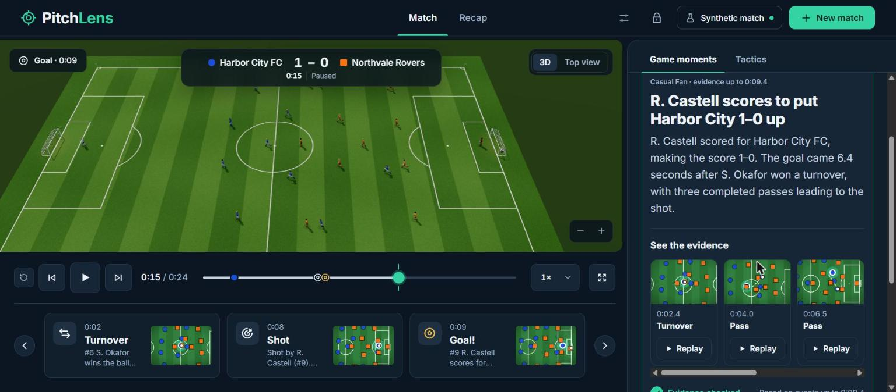
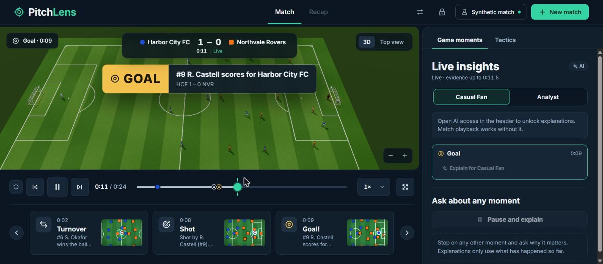
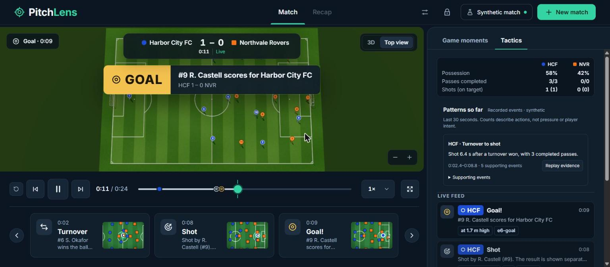
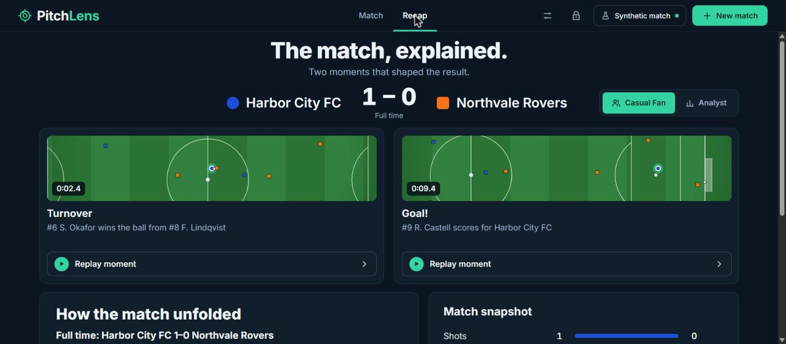
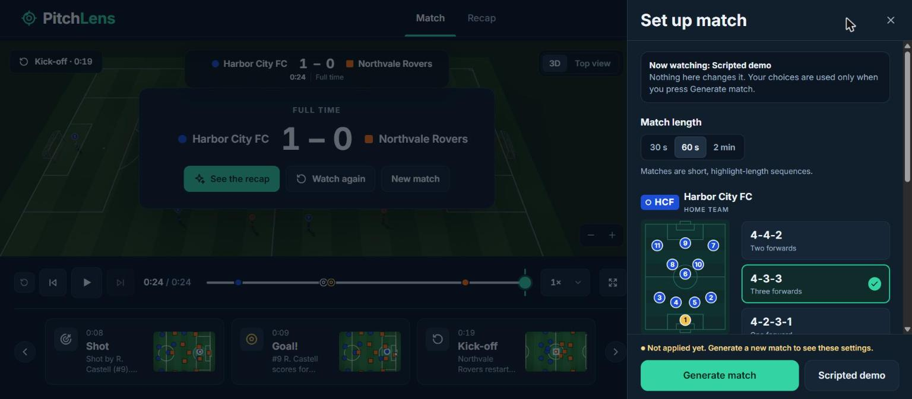
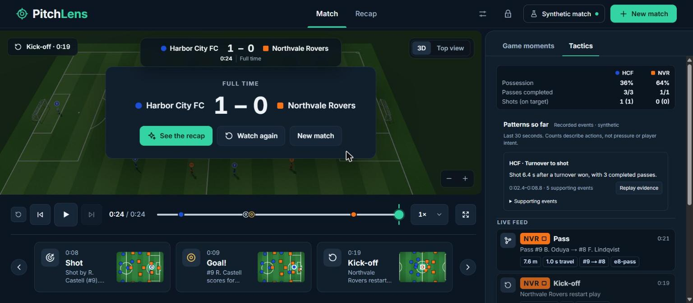

# PitchLens

**Explainable match intelligence for synthetic football, beside an interactive 3D replay.**

PitchLens helps viewers understand *why* a moment matters. It plays a match in
3D, measures what happened from the recorded events, and uses a model on
**Microsoft Foundry** to explain key moments, with every claim tied to evidence
you can replay. Casual fans get a short account; analysts get the observed
facts, a tactical reading and the limits of the evidence. Both use the same
evidence.



> **Everything is synthetic.** Teams, players, movement and events are made up
> by a simulator. No real match data is used, and the app labels every match
> as synthetic.

## Contents

- [What it does](#what-it-does)
- [How explanations stay honest](#how-explanations-stay-honest)
- [Microsoft technology used](#microsoft-technology-used)
- [Quick start](#quick-start)
- [Using PitchLens](#using-pitchlens)
- [Configuration](#configuration)
- [Project structure](#project-structure)
- [Testing](#testing)
- [Limitations](#limitations)
- [Documentation](#documentation)

## What it does

### Watch it like a match on TV



- A full 3D pitch rendered with Three.js, with a **3D** broadcast camera and a
  **Top view**, zoom and pan.
- A score bug, pop-ups for goals, tactical changes, fouls, offsides and
  penalties, a timeline with a marker for every key moment, and a strip of
  moment cards you can jump between.
- An **offside review**: the pitch freezes at the pass and draws the offside
  line and the flagged player before play resumes.
- Playback at 0.5× to 4×, seeking, previous/next moment and full screen.
  Nothing on screen ever shows an event before it happens, including after
  seeking backwards.

### Get AI explanations as the match happens

- **Live insights.** When play reaches a goal, a shot result, a foul, an
  offside or a formation change, PitchLens asks for an explanation without
  pausing. The request is cut off at that moment's time.
- **Ask about any moment.** Pause anywhere and press **Pause and explain**.
- **Two audiences, one set of evidence.** *Casual Fan* gets a short plain
  account; *Analyst* gets observed facts, an optional tactical reading and
  stated limitations. A match starts in *Analyst* when the **Tactics** tab is
  on, and in *Casual Fan* otherwise; switching audience is always available.
- **See the evidence.** Each claim cites the events or positions it is based
  on, and every cited event has a **Replay** button.
- **Honest failures.** When an answer does not pass the checks, PitchLens does
  not show it. It shows the facts recorded for that moment instead, as a
  separate kind of card marked **Match facts, not AI** everywhere it appears,
  with a **Get AI explanation** button to try again.

### Measure what happened



The **Tactics** tab shows possession, completed passes and shots so far, and
**Patterns so far**: turnover-to-shot sequences and repeated flank actions.
Each pattern lists its
supporting events and can be replayed. Patterns describe recorded actions only,
not pressure, intent or chance quality. See the
[pattern definitions](docs/match-patterns.md).

### Recap the match at full time



**Recap** opens at full time with the moments that shaped the result, a
full-time summary of how the match unfolded, the final numbers and every
moment you asked about.

### Generate your own matches



Start with the scripted demo, or generate a reproducible match from a seed.
Choose the match length (30 s, 60 s or 2 min), each team's formation (4-4-2,
4-3-3 or 4-2-3-1) and an optional formation change during the match. A
fixed-timestep simulator plays it out with ball physics, collisions, fouls,
offsides, restarts and set pieces. The same seed and settings always produce
the same match.

### Make it yours

**Preferences** in the header lets you pick a favorite team or player. Live
insights, measured patterns and recap highlights then focus on them. Both
audiences still use the same underlying evidence.

## How explanations stay honest

Every explanation request goes through a bounded workflow on the server
(`src/server/analyst.ts`):

```
selected time ──► evidence package ──► analyst model ──► checks ──► verifier model ──► answer
 (no later data)   events, positions,   may call cutoff-   contract,   reviews every       │
                   score, measurements  bound tools        citations,  claim against      │
                                                           wording     the evidence       │
                         rejected? one revision with the problems found ◄─────────────────┤
                         still rejected? recorded match facts, never the rejected text ◄──┘
```

- **No future data.** The evidence package, and every tool the analyst can
  call, contains only events revealed by the selected time. This is enforced in
  code, not in the prompt. Scheduled formation changes and outcomes not yet
  revealed are never included.
- **Every claim cites evidence.** Facts and interpretations must cite events or
  position snapshots that exist in the evidence the model was given. The
  browser repeats these checks before showing an answer.
- **Deterministic wording checks** reject later times, wrong scores, players
  the cited evidence does not involve, and events (a shot, a penalty, a save…)
  that the cited evidence does not contain.
- **A separate verifier** reviews the headline, the explanation and every
  claim against the same evidence.
- **Bounded cost.** Model calls, tool calls, tokens and time are capped per
  request. Provider throttling is paced and retried at most once.
- **Facts separate from interpretation.** Observable facts may not assert
  intent or cause. When the evidence is not enough, the answer says so.

These checks reduce mistakes; they do not prove a claim is true. A citation
shows that a reference exists, not that the sentence citing it is correct.

The design, limits and failure handling are documented in
[the analyst service guide](docs/explain-service.md) and
[the evidence and response contract](docs/explain-this-moment.md).

## Microsoft technology used

- **Microsoft Foundry** hosts the model deployment used for live explanations.
- The Next.js server calls it through the **Azure OpenAI-compatible v1 chat
  completions API**, with structured JSON output and server-only credentials.
- **Microsoft Foundry cloud evaluations** score retained live explanations
  with the built-in groundedness, relevance and coherence evaluators (with a
  `gpt-5-mini` judge), plus content-safety and indirect-attack evaluators for
  the planted-instruction scenarios, through `@azure/ai-projects` and
  `DefaultAzureCredential`. The scores are informational and sit beside the
  deterministic checks; see [AI evaluation](docs/ai-evaluation.md#microsoft-foundry-cloud-evaluation-informational).
- The analyst, tool, verifier and revision steps are implemented in
  TypeScript. **Microsoft Agent Framework** was evaluated but is not used; see
  [why](docs/explain-service.md#why-not-microsoft-agent-framework).

Azure App Service hosts the deployed application. Fabric, MCP and managed
databases are not used.

## Quick start

Requires Node.js 20.9 or newer (CI uses Node.js 22).

```bash
npm install
npm run dev        # http://127.0.0.1:3000
```

Choose **Kick off the demo**. Playback, statistics and patterns work without
any configuration.

To enable AI explanations:

1. Copy `.env.example` to `.env.local`.
2. Set `FOUNDRY_ENDPOINT`, `FOUNDRY_API_KEY` and `FOUNDRY_DEPLOYMENT`.
3. Set a random `PITCHLENS_JUDGE_ACCESS_CODE` (16–256 characters) and a
   separate `PITCHLENS_SESSION_SECRET` (at least 32 characters). For local
   development only, you can set `PITCHLENS_ACCESS_MODE=local` instead.
4. Restart the server, open **AI access** (the lock icon in the header) and
   enter the access code.

Credentials stay on the server. Never put them in `NEXT_PUBLIC_` variables.

| Command | What it does |
| --- | --- |
| `npm run dev` | Development server with hot reload |
| `npm run build` / `npm start` | Production build, then serve it |
| `npm test` | Offline test suite (Vitest); models are mocked |
| `npm run typecheck` | TypeScript checking |
| `npm run check` | Tests, type checking and production build, as run in CI |
| `npm run test:live` | Opt-in live evaluation against your Foundry deployment (makes paid calls; see [AI evaluation](docs/ai-evaluation.md)) |

## Using PitchLens



| Where | What you can do |
| --- | --- |
| Header | Switch between **Match** and **Recap**, open **Preferences** (sliders icon) and **AI access** (lock icon), start a **New match** |
| Pitch | Switch **3D** / **Top view**, zoom with − / +, the mouse wheel or a pinch, and drag to pan when zoomed in |
| Control bar | Restart, previous/next key moment, play/pause, seek on the timeline, change speed, go full screen |
| Moment strip | Jump to any key moment reached so far |
| **Game moments** tab | Live insights, **Pause and explain**, Casual Fan / Analyst, the evidence behind each answer, and your saved explanations |
| **Tactics** tab | Live numbers, measured patterns with **Replay evidence**, and a feed of every touch |
| **Recap** | The defining moments, the full-time summary, the final numbers and every moment you asked about |

Without WebGL, a message replaces the 3D view and everything else still works.
All controls are native buttons and inputs, reachable by keyboard, with visible
focus. Team identity is shown by name and shape as well as colour, and
`prefers-reduced-motion` turns animation off.

## Configuration

The required settings are listed in [Quick start](#quick-start). Optional
settings are documented in [`.env.example`](.env.example), including:

| Setting | Purpose |
| --- | --- |
| `FOUNDRY_VERIFIER_DEPLOYMENT` | A separate deployment for the verifier |
| `FOUNDRY_REQUESTS_PER_MINUTE` | Paces calls to match your deployment's quota |
| `FOUNDRY_REASONING_EFFORT`, `FOUNDRY_TEMPERATURE` | Model settings, only if the deployment supports them |
| `PITCHLENS_DAILY_TOKEN_BUDGET`, `PITCHLENS_SESSION_EXPLANATIONS` | Usage allowances |
| `PITCHLENS_EXPLANATIONS_DISABLED` | Emergency stop for all explanation requests |

Access control, allowances and abuse protection are described in
[security controls](docs/security-controls.md).

### Azure App Service

`.github/workflows/main_pitchlens.yml` builds, tests and deploys `main` to an
Azure App Service (Linux, Node 22) as one prebuilt zip. The web app needs:

- Startup command: `node node_modules/next/dist/bin/next start --hostname 0.0.0.0`
  (`npm start` listens on loopback only, for local use).
- `SCM_DO_BUILD_DURING_DEPLOYMENT=false`, so App Service runs the uploaded
  build instead of rebuilding it.
- The settings from [Quick start](#quick-start) as app settings, with
  production values for the access code and session secret.
- A single instance: allowances and the answer cache are kept in memory.

See the [hosting runbook](docs/hosting-runbook.md) for release checks and rollback,
and [judge instructions](docs/judge-instructions.md) for the public walkthrough.

## Project structure

```
src/
  match/        Versioned fixture contract, the scripted demo, validation
  simulation/   Seeded match simulator: rules, ball physics, collisions, formations
  playback/     Pure functions of (fixture, time): positions, score, statistics,
                key moments, patterns, recap highlights
  explain/      Evidence package, response contract, grounding checks, prompts,
                recorded match summaries (no network or React code)
  server/       /api/explain: Foundry client, analyst/verifier workflow,
                access sessions, rate limits and caching
  scene/        Three.js pitch, footballers, ball and cameras
  components/   React UI
  app/          Next.js App Router page, layout and API routes
tests/          Offline Vitest suites
tests-live/     Opt-in live evaluation
```

Everything on screen is derived from the fixture and the current playback
time, so results do not depend on frame rate, and seeking backwards always
restores an earlier state exactly.

## Testing

`npm test` runs the offline suites. They cover the simulator, playback and
seeking, statistics, patterns, preferences, and the explanation workflow with
mocked models: future-data exclusion, backward seeking, invalid and
unsupported citations, wording checks, model and provider failures, retries,
and the recorded-facts fallback.

GitHub Actions runs `npm run check` (tests, type checking and the production
build) on pull requests and pushes to `main`. Live model quality is measured separately with
`npm run test:live`; offline tests do not show how a live model performs.

## Limitations

- Matches are short, highlight-length sequences, and the rules and tactics are
  simplified.
- Explanations depend on a live model. Some answers fail the checks; you then
  see the recorded match facts, marked as not AI, rather than an AI explanation.
- Measured patterns and derived measurements (pass distance and travel time,
  pass completion, possession spells, movement, nearby opponents) cover recent
  windows of recorded data. They do not measure pressure, intent or chance
  quality.
- Players are drawn larger than life so they stay readable from the
  full-pitch camera.
- Azure App Service deployment is available. The hosted judge walkthrough and
  live evaluation status are tracked in [release readiness](docs/release-readiness.md).

## Documentation

| Document | Contents |
| --- | --- |
| [Analyst service](docs/explain-service.md) | `/api/explain`, the workflow, limits, failure handling, Agent Framework evaluation |
| [Evidence and response contract](docs/explain-this-moment.md) | What the model sees, the response schema, citation rules |
| [Match patterns](docs/match-patterns.md) | Pattern definitions and coverage limits |
| [AI evaluation](docs/ai-evaluation.md) | Offline checks versus live quality, the live evaluation |
| [Security controls](docs/security-controls.md) | Access, allowances, kill switch, hosting requirements |
| [3D rendering](docs/3d-rendering.md) | Scene, models and assets |
| [Submission guide](docs/submission.md) | Elevator pitch and demo script |
| [Development history](docs/development-history.md) | The milestone-by-milestone record of how PitchLens was built |
